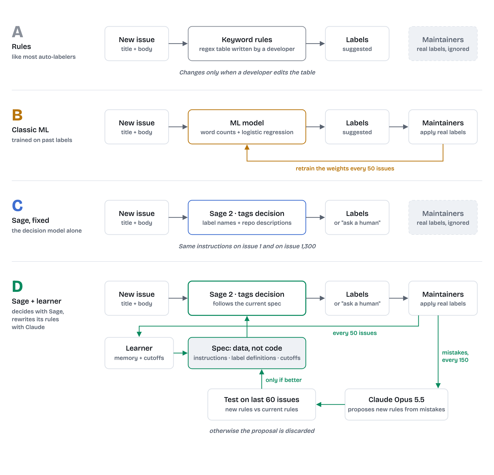
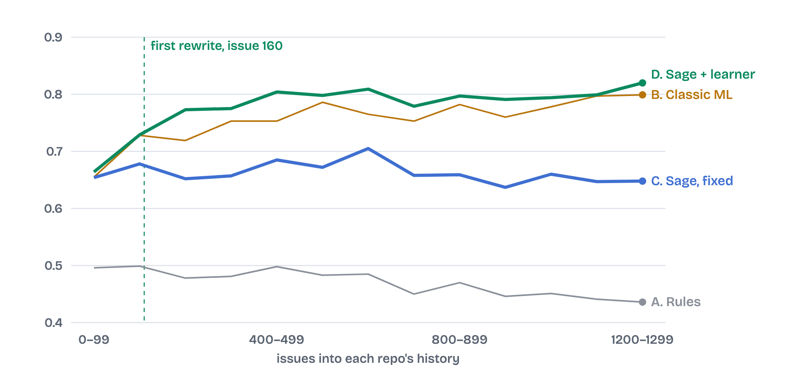
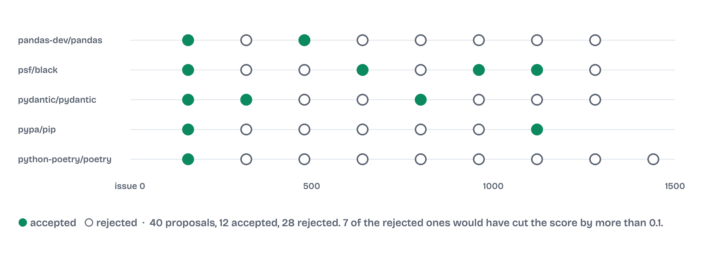

A few weeks ago I set out to dig deeper into decision models. At first, short on time, I had simply confined them to classification. OK, I know, that's what they're for, and being able to use them for that is already a great result :D Still, I had a feeling there could be something more, but I couldn't picture what.

Then I started experimenting a little, not so much to find the application of the year built on decision models, but mostly to begin understanding their limits and their potential. In this article I want to share the first experiment, and more will certainly follow. My hope is to start a virtuous circle and get others to experiment and find interesting applications. And of course, I'm always open to constructive feedback!

> **The goal is to experiment with an approach, not to build the best code.** Issue labelling is just a convenient place to watch the loop work. None of the versions here is tuned to win, and a well-tuned ML model could beat them all. That's fine: the numbers are here to show the loop working, not to rank decision models against ML.



## 🤔 What if the `if` statements could rewrite themselves?

Most product logic is a pile of `if` statements. Someone watches how users behave, decides the rules are wrong, edits the code and ships it. The software only gets smarter when a developer does.

Decision models like [Levanto Sage 2](https://docs.levanto.ai) change what that logic can be. You send some content and a question, and you get back a structured answer with a probability, in milliseconds, for a fraction of a cent. You can call one wherever you'd write an `if`.

The interesting part: the rules a decision model follows are **plain-English instructions and definitions**. That means they're *data*. And data can be rewritten by a program.

So here's the idea I wanted to test:

- a **decision model** makes every decision, thousands of times, fast and cheap
- an **LLM** reads where those decisions went wrong and proposes better instructions
- a **plain test** on recent history decides whether the new instructions go live

If it works, you get software that improves from how people use it, with nobody touching the code.

## 🧪 The test bed: labelling GitHub issues

I needed a feature where users produce feedback without being asked. Issue triage is perfect: a new issue arrives, the software suggests labels, and a few hours later the maintainers apply the labels they actually wanted. Every issue tells the software whether it was right.

I replayed the real history of five public repositories: **pandas, black, pydantic, pip and poetry**. That's 6,643 issues in date order, about 12 content labels per repo. Each repo has its own labelling habits that nobody explains to the software.

The rule of the replay is simple: **decide first, then see what the maintainers did.** No peeking.

## 🏗️ Four ways to build the same feature

I built the same feature four times. Every version gets the same issue, in the same order, and has to answer before the maintainers' labels are revealed. They differ in *what decides* and in *what changes afterwards*.



| Version | What decides | What changes over time |
|---|---|---|
| **A. Rules** | A regex table, like most auto-labelers | Nothing, until a developer edits it |
| **B. Classic ML** | TF-IDF + logistic regression | Its weights, retrained every 50 issues |
| **C. Sage, fixed** | A Sage 2 `tags` decision from label names + descriptions | Nothing. The decision model alone. |
| **D. Sage + learner** | The same Sage decision as C | **Its own rules** |

D is the one I care about. Three things in it evolve:

1. **Memory:** each issue is sent with a few similar past issues and the labels they got.
2. **Cutoffs:** each label gets its own probability threshold, tuned on the repo's history.
3. **Rules:** every 150 issues, Claude Opus 5.5 reads recent mistakes and proposes new instructions and label definitions.

Here is the whole rewrite step, simplified:

```python
every 150 issues:
    proposal = claude.propose(current_spec, recent_mistakes)
    if score(proposal, last_60_issues) >= score(current_spec, last_60_issues) + 0.01:
        current_spec = proposal        # the software changed its own rules
    log(proposal, scores)              # every change is explained and auditable
```

Claude never labels a single issue. Sage makes all 6,643 decisions per version. Claude is called rarely, to think about *patterns*: 40 times in the whole experiment.

In code, C and D share the same Sage request. D adds about 90 lines on top.

## 📈 So, did it evolve?

The comparison that matters is **C against D**. Same model, same issues, same starting instructions. The only difference is the loop.



C starts where D starts and stays flat. D climbs as soon as its first rewrite lands at issue 160, and keeps the gain.

| Version | F1, all issues | First 50 issues | New labels | Who changes it |
|---|---:|---:|---:|---|
| A. Rules | 0.469 | 0.503 | 0.229 | a developer |
| B. Classic ML | 0.760 | 0.552 | 0.068 | retraining |
| C. Sage, fixed | 0.661 | 0.650 | 0.383 | nobody |
| D. Sage + learner | **0.778** | **0.663** | **0.619** | **itself** |

Classic ML ends up close to D, and that's expected: issue labelling has thousands of examples and fixed categories, which is exactly what ML likes. What D shows is something different:

- **It's useful from day one.** Sage starts from label names and descriptions, so the first 50 issues of each repo are already labelled reasonably. ML has nothing to learn from yet.
- **It handles labels it has never seen.** On the first 15 uses of a label the maintainers added partway through, D scores **0.62 F1** and ML scores **0.07**.

## ✍️ Watching it rewrite itself

Every 150 issues, D asked Claude for new rules and tested them. Each dot is one proposal:



**40 proposals, 12 accepted, 28 rejected.** Every repo accepted its first one. After that, the rules were already good and most ideas lost. Two real examples, one of each.

### ✅ Accepted: pip learns its own issue templates

For its first 160 issues, the pip bot ran on the generic starting instructions:

> This is a new GitHub issue filed in the pypa/pip repository. Decide which labels the maintainers would apply to it. A label applies only when the issue is clearly about that topic.

It was too generous. It kept adding `type: enhancement` next to `type: feature request`, and stuck area labels on anything that mentioned them. Claude looked at those mistakes and wrote this:

> Maintainers label sparingly: usually exactly one 'type:' label, chosen mainly by issue template. 'Description / Expected behavior / How to Reproduce' issues get 'type: bug', even if the user may be at fault. 'What's the problem this feature will solve?' issues get 'type: feature request'. Add a 'C:' or 'project:' label only when that area is clearly the core subject.

Nobody told it that pip's labels follow its issue templates. It worked that out from the maintainers' behaviour. On the 60 held-out issues the new rules scored **0.78** against **0.58**, so they went live. The very next issues:

| Issue | Maintainers | C, old rules forever | D, rewritten rules |
|---|---|---|---|
| [#11460](https://github.com/pypa/pip/issues/11460) Support downloading pyproject.toml build deps with parameter | `type: feature request` | `type: feature request` ~~`type: enhancement`~~ | `type: feature request` ✅ |
| [#11461](https://github.com/pypa/pip/issues/11461) Unclear warnings when extras_require causes unsatisfiable dependencies | `type: feature request` | `type: feature request` ~~`type: enhancement`~~ ~~`C: error messages`~~ ~~`C: dependency resolution`~~ | `type: feature request` ✅ (+ `C: dependency resolution` flagged as unsure) |

Struck-through labels are wrong. "Unsure" means Sage answered `null`, so that label would go to a human instead of being applied.

### ❌ Rejected: poetry almost forgets what it learned

At issue 160, the poetry bot had learned that its maintainers almost never apply area labels at triage. Around issue 960, Claude saw a batch of mistakes where some area labels *had* been used, and proposed bringing them back:

| Live rules | Claude's proposal |
|---|---|
| "Area labels are applied very rarely at triage; default to NO area label even when the topic seems related (solver, venv, cli, deps, sources, etc.)." | "Then add area labels for the subsystem where the failure clearly lies; multiple areas may apply (e.g., solver+sources+vcs)." |

On the next 60 issues the maintainers barely used area labels, and the proposal would have added wrong ones everywhere. The test scored it **0.60** against **0.92**, and the software kept what it had.

This is the part that makes running without a human acceptable. **The LLM can have a bad idea. The software checks every idea against its own data before trusting it.** 7 of the 28 rejected proposals would have cut the score by more than 0.1.


Every proposal, accepted or rejected, is logged with both scores and the complete instructions and label definitions in [`results/runs/D_Sage_plus_learner/`](https://github.com/ssantomauro/self-evolving-triage/tree/main/results/runs/D_Sage_plus_learner), one `.state.json` file per repo.


## 💸 What did it cost?

- **Sage:** about **$5.50** for every decision in the experiment, around 16,900 of them including the pilot and every proposal test. Roughly $0.0003 per decision.
- **Claude Opus 5.5:** 40 calls, one per proposal.
- **Infrastructure:** none. No training pipeline, no labelled dataset to prepare, no model to host. The learner is about 140 lines of Python.

Because every decision is cheap, the software can afford to **re-run the past**. That's how the test works: before trusting new rules, it replays 60 recent issues with both versions and compares.

## 🌍 Where else could this live?

Issue labelling is just a convenient place to watch it. The pattern needs three things:

1. a decision the software makes **often**
2. a **signal** users produce anyway that shows whether it was right
3. rules that can be written in **plain language**

Plenty of products have all three:

| Product | Decision the model makes | Signal users produce anyway | What rewrites itself |
|---|---|---|---|
| Support desk | Which team gets this ticket | Which team finally solves it | Routing rules per team |
| CRM | Is this lead worth a call today | Deals won and lost | What a good lead looks like |
| Onboarding | Which next step to show this user | Where users drop off | The rules for each step |
| Moderation | Remove, warn or allow | Appeals that succeed | The policy definitions |
| Expense tool | Approve or send to review | What finance overturns | The approval policy |
| Inbox | Urgent or later | What the user opens first | That user's idea of urgent |

In each case the work splits the same way. The decision model makes thousands of fast, cheap calls. The LLM makes a few slow, thoughtful ones about what the patterns mean. A plain test decides which ideas survive. And because the rules are text, every change can be read, explained and rolled back.

Sage 2 and Claude are just what this run used. The code can be adjusted to use other LLMs and decision models: a new client and request mapping for the decision model, a different API call in the rewrite step for the LLM. The learner and the test stay the same.

## ⚠️ What's the catch?

- **The loop is only as good as its signal.** A repo whose maintainers don't label gives it nothing to learn from.
- **The test uses 60 recent issues.** That catches bad ideas like the poetry one, but close calls can go either way.
- **It's a replay, not a live product,** and five Python repositories are a small world.

## 🚀 Try it yourself

Everything is in the repo: the four versions, the replay harness, and every decision each version made.

```bash
make install && make fetch      # download the issue histories
make classic                    # versions A and B, free
export SAGE_API_KEY=...         # plus ANTHROPIC_API_KEY for version D
make sage && make report
```

Every API response is cached, so an interrupted run resumes where it stopped and re-plotting costs nothing.

---

This is the first of a few experiments I want to run with decision models. **Where would you put this loop in a product you work on?** And if you've tried something similar, with Sage or another decision model, I'd love to hear how it went in the comments 👇
