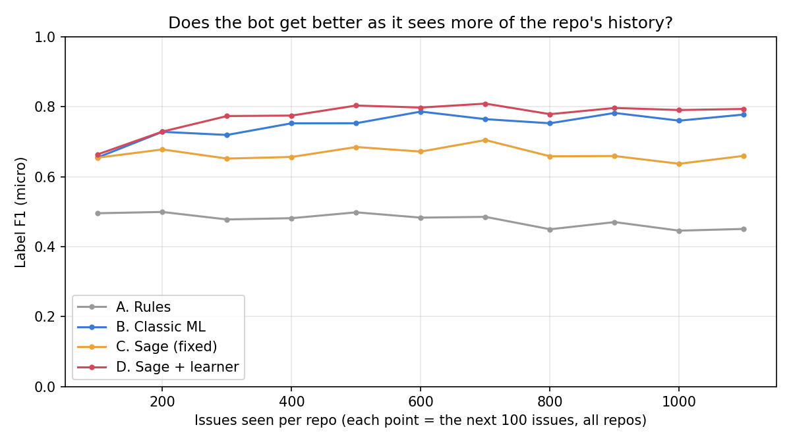

# Results

| Version | Label F1 (all) | First 50 issues | Second half | New labels (first uses) | Issues flagged for a human | Lines of decision logic |
|---|---:|---:|---:|---:|---:|---:|
| A. Rules | 0.469 | 0.503 | 0.453 | 0.229 | 0.0% | 52 |
| B. Classic ML | 0.760 | 0.552 | 0.780 | 0.068 | 0.0% | 45 |
| C. Sage (fixed) | 0.661 | 0.650 | 0.654 | 0.383 | 5.4% | 52 |
| D. Sage + learner | 0.778 | 0.663 | 0.795 | 0.619 | 1.7% | 143 |

Every version is scored on the same 6,643 issues.

## Per repo (label F1)

| Version | pandas-dev/pandas | psf/black | pydantic/pydantic | pypa/pip | python-poetry/poetry |
|---|---:|---:|---:|---:|---:|
| A. Rules | 0.548 | 0.508 | 0.379 | 0.454 | 0.446 |
| B. Classic ML | 0.756 | 0.691 | 0.813 | 0.685 | 0.851 |
| C. Sage (fixed) | 0.812 | 0.677 | 0.685 | 0.553 | 0.586 |
| D. Sage + learner | 0.831 | 0.753 | 0.780 | 0.683 | 0.830 |
